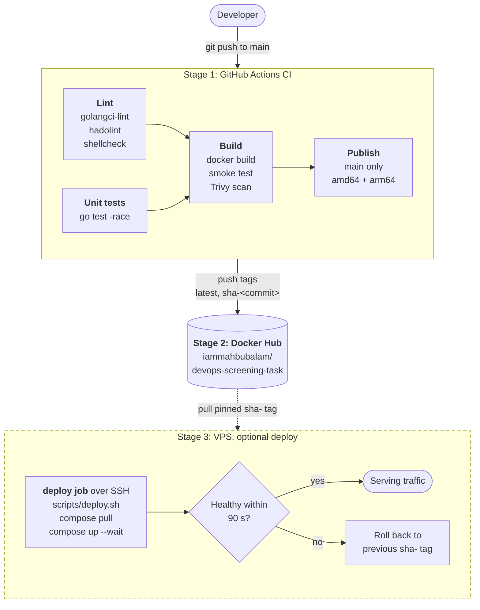

# devops-screening-task

[](https://github.com/iammahbubalam/devops-screening-task/actions/workflows/ci.yml)

This repo holds a small Go web service packaged as a hardened container. A GitHub Actions pipeline lints, tests, scans and publishes the image to Docker Hub, and a Bash script logs the health of the host.

It is my submission for the Care Guide DevOps screening task.

- Image: [`iammahbubalam/devops-screening-task`](https://hub.docker.com/r/iammahbubalam/devops-screening-task) for `linux/amd64` and `linux/arm64`
- Pipeline diagram: [below](#cicd-pipeline), or as an image in [docs/pipeline.png](docs/pipeline.png)

## Where each requirement lives

| Task requirement | File |
|---|---|
| Web app, `/` returns the JSON message | [app/handler.go](app/handler.go), [app/main.go](app/main.go) |
| Production-ready Dockerfile: multi-stage, small, non-root | [Dockerfile](Dockerfile), [.dockerignore](.dockerignore) |
| docker-compose on port 8080 | [docker-compose.yml](docker-compose.yml) |
| CI on push to `main`: lint, build, push to Docker Hub | [.github/workflows/ci.yml](.github/workflows/ci.yml) |
| Diagram: commit → CI → Docker Hub → VPS | [CI/CD pipeline](#cicd-pipeline) |
| `system_health.sh` writing `health_log.txt`, warning above 80% disk | [scripts/system_health.sh](scripts/system_health.sh) |
| How I would deploy to AWS | [Deploying to AWS EC2 or a VPS](#deploying-to-aws-ec2-or-a-vps) |
| Extra, not required: automatic deploy to a VPS over SSH, off by default | [Optional: deploy to a VPS](#optional-deploy-to-a-vps-over-ssh), [scripts/deploy.sh](scripts/deploy.sh), [docker-compose.prod.yml](docker-compose.prod.yml) |

## Repository layout

```
.
├── .github/
│   ├── workflows/ci.yml     CI pipeline
│   └── dependabot.yml       weekly updates for pinned actions, images and Go
├── app/                     Go service, standard library only
│   ├── main.go              config, HTTP server, graceful shutdown, -healthcheck
│   ├── handler.go           routes and JSON response
│   └── *_test.go            unit tests
├── scripts/
│   ├── system_health.sh     host health check (Step 3)
│   ├── smoke_test.sh        runs the image and checks the response (used by CI)
│   └── deploy.sh            runs on the server: start a tag, health-check it, roll back (optional deploy)
├── docs/pipeline.png        pipeline diagram as an image
├── Dockerfile
├── docker-compose.yml       local run, builds the image from source
├── docker-compose.prod.yml  server run, pulls the image from Docker Hub (optional deploy)
└── Makefile                 shortcuts for the commands below
```

## Run the app

You need Docker Engine 24 or newer with the Compose v2 plugin. Check with `docker compose version`. Nothing else has to be installed.

```bash
git clone https://github.com/iammahbubalam/devops-screening-task.git
cd devops-screening-task
docker compose up --build -d
```

> The task text says `docker-compose up`. That is the old standalone Compose v1 command, which reached end of life in 2023. `docker compose` (with a space) is the current one. If you have the standalone v2 binary, `docker-compose up --build -d` works the same way.

Check that it works:

```console
$ curl -s http://localhost:8080/
{"message":"Hello from DevOps Intern Task!","status":"running"}
```

`docker compose ps` should show `(healthy)` in the STATUS column after a few seconds. The image has its own health check, described [below](#docker-image).

To follow the logs, or to stop and remove the container:

```bash
docker compose logs -f
docker compose down
```

To run the published image without cloning the repo:

```bash
docker run --rm -p 8080:8080 iammahbubalam/devops-screening-task:latest
```

**Behaviour**

| Request | Response |
|---|---|
| `GET /` or `HEAD /` | `200` with the JSON above, `Content-Type: application/json` |
| Any other method on `/` | `405 Method Not Allowed` |
| Any other path | `404 Not Found` |

The only setting is `PORT`, the port to listen on (default `8080`).

The service logs JSON lines to stdout. On `docker compose down` it receives SIGTERM, finishes requests that are still running, and exits within a second instead of being killed after Docker's 10-second grace period:

```json
{"time":"2026-11-06T18:37:10.757Z","level":"INFO","msg":"server listening","addr":"[::]:8080"}
{"time":"2026-11-06T18:37:12.833Z","level":"INFO","msg":"shutdown signal received, draining connections","timeout":"5s"}
{"time":"2026-11-06T18:37:12.833Z","level":"INFO","msg":"shutdown complete"}
```

## Run the health script

`scripts/system_health.sh` runs on any Linux host with bash, awk and df. It is stored as executable in git, so you can run it straight away:

```console
$ ./scripts/system_health.sh
2026-11-07T00:37:43+06:00 host=ghost cpu=2.9% mem=46.6% disk=72% status=OK
```

Each run prints one line and appends the same line to `health_log.txt` in the current directory. If disk usage is above the threshold, the line ends in `status=WARNING` and the warning goes to stderr. To see that path without filling a disk, lower the threshold:

```console
$ DISK_THRESHOLD=1 ./scripts/system_health.sh
2026-11-07T00:37:45+06:00 host=ghost cpu=3.6% mem=46.6% disk=72% status=WARNING
[WARNING] Disk space high! / is 72% full (threshold 1%)
```

| Variable | Default | Meaning |
|---|---|---|
| `LOG_FILE` | `./health_log.txt` | File to append to |
| `DISK_THRESHOLD` | `80` | Warn when disk usage is above this percentage (whole number, 1–100) |
| `DISK_PATH` | `/` | Filesystem to check |

The exit code is `0` when the check ran, including when it printed a warning, and `1` on bad input or when it cannot read `/proc` or write the log. `--help` prints usage.

**How it measures**

- **CPU.** It reads `/proc/stat` twice, one second apart, and reports the share of time that was not idle. A single reading only gives totals since boot, and the first sample from `top -bn1` has the same problem.
- **Memory.** It reports `(MemTotal - MemAvailable) / MemTotal` from `/proc/meminfo`. `MemAvailable` is the kernel's own estimate of memory that programs can still get, so page cache does not show up as "used".
- **Disk.** It uses `df -P` on `DISK_PATH`. `-P` keeps every filesystem on one line, so parsing does not break on long device names.

The log is one `key=value` line per run, so it is easy to `grep status=WARNING` or to ship it to a log system. To run it every five minutes from cron:

```cron
*/5 * * * * LOG_FILE=/var/log/system_health.log /opt/devops-screening-task/scripts/system_health.sh
```

## CI/CD pipeline



Stages 1 and 2 are what the task asks for, and they run on every push to `main`. Stage 3 is drawn dashed because it is an optional extra: it runs only when a server is connected and the repository variable `DEPLOY_ENABLED` is `true`. [Setup is described below](#optional-deploy-to-a-vps-over-ssh).

**Triggers.** Every push to `main` runs the four jobs below and publishes the image. Pull requests into `main` run the same checks but skip `publish`, so nothing reaches Docker Hub before review.

| Job | What it does | What it catches |
|---|---|---|
| `lint` | golangci-lint (including gosec), hadolint, shellcheck | Go bugs and security smells, Dockerfile mistakes, unsafe shell |
| `test` | `go test -race -cover` | Wrong responses and routing, data races, broken shutdown |
| `build` | Builds the image, runs [smoke_test.sh](scripts/smoke_test.sh), scans with Trivy | Images that fail to build, run as root, or don't return the JSON, and HIGH or CRITICAL CVEs that have a fix |
| `publish` | Builds for amd64 and arm64, then pushes `latest` and `sha-<commit>` with an SBOM and provenance | Runs only on `main`, and only after the three jobs above pass |
| `deploy` (optional) | Copies the compose file and [deploy.sh](scripts/deploy.sh) to the server over SSH and runs it | Skipped unless `DEPLOY_ENABLED` is `true`, so it never turns the pipeline red on a repo without a server |

Choices in the workflow:

- **Least privilege.** The workflow token can only read the repo. Only the `publish` job sees the Docker Hub token, and only the `deploy` job sees the SSH key.
- **Pinned actions.** Every third-party action is pinned to a full commit SHA, not a tag, because tags can be moved to other code. That happened in the tj-actions/changed-files compromise in March 2025. Dependabot opens weekly PRs to update the SHAs, the base image digests and Go.
- **Two image tags.** `sha-<commit>` never changes. A deploy pins it, so every running container maps to one commit and a rollback means redeploying the previous tag. `latest` is only there for convenience.
- **Fast rebuilds.** Layers are cached in the GitHub Actions cache, so `publish` reuses the amd64 layers that `build` just made.

**Using it in a fork.** Create a Docker Hub access token with Read & Write scope (Account settings → Personal access tokens). Then:

```bash
gh variable set DOCKERHUB_USERNAME --body <your-docker-hub-user>
gh secret set DOCKERHUB_TOKEN      # paste the token when prompted
```

## Docker image

| | |
|---|---|
| Size | 9.6 MB. The Go binary is 7.3 MB of that |
| Base | `gcr.io/distroless/static-debian13:nonroot`, pinned by digest |
| User | `65532:65532` (non-root) |
| Shell or package manager | None |
| Health check | `/server -healthcheck` every 30 s |

Why it is built this way:

| Decision | Reason |
|---|---|
| Multi-stage build | The Go build image (253 MB) stays in the build stage. Only the binary is copied into the final image. |
| distroless `static` rather than `scratch` | It is about the same size, and it already includes CA certificates, tzdata and a non-root user. Google patches it. With `scratch` I would have to add `/etc/passwd` and certificates by hand. |
| No shell in the image | If someone breaks into the process, there is no shell, curl or package manager for them to use. |
| `CGO_ENABLED=0 -trimpath -ldflags="-s -w"` | This gives a static binary that needs no libc, contains no local file paths, and has no debug symbols. |
| `USER 65532:65532` as a number | Kubernetes `runAsNonRoot` can only verify a numeric UID. |
| Cross-compiling with `--platform=$BUILDPLATFORM` | The arm64 image is built natively with Go's cross-compiler, without QEMU emulation, so multi-arch builds stay fast. |
| `go.mod` copied before the source | Editing code does not invalidate the dependency layer. |
| `.dockerignore` as an allowlist | Only `app/` is sent to the builder. `.git`, `.env` files and notes can never end up in an image. |
| Health check in the binary | There is no curl in the image, so `/server -healthcheck` sends a GET to `/` itself. `/` is static and cheap, so I did not add a second endpoint. The task asks for a single one. |
| Tags and digests written out in full | Builds are reproducible, and Dependabot can update them. Dependabot cannot update a `FROM` line that is built from an `ARG`. |

[docker-compose.yml](docker-compose.yml) adds runtime hardening on top:

- a read-only root filesystem
- all Linux capabilities dropped
- `no-new-privileges`
- limits of 0.5 CPU and 64 MB memory, so a runaway container cannot starve the host
- `restart: unless-stopped`

It has no `version:` key, because that key is obsolete in the Compose Specification and only prints a warning.

## Local checks

The Makefile wraps the commands above. The linters run in their official Docker images, pinned to the same versions CI uses, so `make lint` works without installing anything except Docker.

```console
$ make
  help    List available targets
  up      Build and start the app on http://localhost:8080
  down    Stop and remove the app
  logs    Follow the app's logs
  build   Build the Docker image
  test    Run the Go unit tests (needs Go 1.27+)
  lint    Lint Go code, the Dockerfile and shell scripts
  smoke   Build the image, run it and check the response
  health  Run the system health check once
  clean   Remove containers, the local image and the health log
```

## Deploying to AWS EC2 or a VPS

- **Ship one exact version.** CI pushes an immutable `sha-<commit>` tag, and the server pulls that tag, never `latest`. Every running container then maps to one commit, and a rollback is a redeploy of the previous tag. The optional `deploy` job below does this.
- **Keep the host small and closed.** One EC2 `t4g.small` (Graviton, which the multi-arch image already supports, about 20% cheaper than the matching x86 instance), created with Terraform. Cloud-init installs Docker. The security group allows only port 80 or 443, plus SSH from my own IP. In a real AWS setup I would drop SSH keys entirely: GitHub OIDC assumes a scoped IAM role, and SSM runs the deploy command.
- **Make a bad release harmless.** A deploy counts as done only when the container's health check passes, and otherwise the previous tag comes back automatically. Logs are rotated so they cannot fill the disk, and `system_health.sh` runs from cron to catch disk and memory trouble early. When one server is no longer enough, the next step is ECS Fargate behind an Application Load Balancer, not more hand-run servers.

## Optional: deploy to a VPS over SSH

This goes beyond the task. A server is not needed to review the repo: with no server connected, the `deploy` job is skipped and everything above stays green.

When enabled, the job runs after `publish`. It copies [docker-compose.prod.yml](docker-compose.prod.yml) and [deploy.sh](scripts/deploy.sh) to the server and runs the script with the new `sha-` tag. The script then:

1. pulls the image. If that fails (wrong tag, registry down), it stops and the running release is untouched;
2. starts the new container with `docker compose up --wait`, which waits for the image's own health check;
3. on success, records the tag in `.env`, deletes image tags older than the previous one, and exits 0;
4. on failure, prints the container logs, restarts the previous tag, and exits 1, so the job is red but the site stays up.

**Set it up**

1. On a fresh Ubuntu server, as root. Open port 22 and port 80 in the provider's firewall (on AWS, the security group). Docker's published ports bypass `ufw`, so a host firewall is the wrong place for this.

   ```bash
   curl -fsSL https://get.docker.com | sh
   adduser --disabled-password --gecos "" deploy
   usermod -aG docker deploy
   install -d -m 700 -o deploy -g deploy /home/deploy/.ssh
   ```

2. On your machine, make a key used for nothing else, and put the public half on the server:

   ```bash
   ssh-keygen -t ed25519 -N "" -f deploy_key -C github-actions-deploy
   cat deploy_key.pub
   ```

   Then on the server, as root, paste that line in:

   ```bash
   echo '<the line printed above>' >> /home/deploy/.ssh/authorized_keys
   chown deploy:deploy /home/deploy/.ssh/authorized_keys && chmod 600 /home/deploy/.ssh/authorized_keys
   ```

3. Give GitHub what it needs, then delete the local copy of the private key:

   ```bash
   gh secret set SSH_HOST --body <server-ip-or-hostname>
   gh secret set SSH_USER --body deploy
   gh secret set SSH_PRIVATE_KEY < deploy_key
   ssh-keyscan <server-ip-or-hostname> | gh secret set SSH_KNOWN_HOSTS
   gh variable set DEPLOY_ENABLED --body true
   rm deploy_key deploy_key.pub
   ```

   `SSH_KNOWN_HOSTS` pins the server's host key. If the key ever differs, the job fails instead of connecting to an impostor. For a non-standard SSH port, also run `gh variable set SSH_PORT --body <port>` and use `ssh-keyscan -p <port>`.

4. Push to `main`. When the `deploy` job is green, `curl http://<server-ip>/` returns the JSON.

**Roll back by hand.** On the server, run the script with an older tag:

```bash
cd ~/devops-screening-task
IMAGE_REPO=docker.io/iammahbubalam/devops-screening-task IMAGE_TAG=sha-<older-commit> ./deploy.sh
```

**Limits, stated plainly**

- **Brief downtime per deploy.** One container is replaced by another, so requests fail for a few seconds. Zero downtime needs two instances behind a proxy, which is more than this service needs.
- **HTTP only.** TLS would mean a domain name and a reverse proxy such as Caddy in front of the container.
- **The deploy user can control Docker**, which is equivalent to root on that machine. Use a dedicated server, or rootless Docker or the SSM approach above for anything serious.
- **What I tested.** `deploy.sh` ran against a local registry for four cases: a good deploy, a second deploy, a broken image that rolled back, and a missing tag. The workflow's SSH commands ran against a throwaway SSH server, including a wrong host key, which was refused. I have not run the job against a real cloud server, because none is attached to this repo.

## What I left out on purpose

- **Kubernetes and Terraform code.** For a single stateless container they only add moving parts. The deployment notes above say where each would come in.
- **Deploy switched on by default.** The task asks for CI and a description of the deployment. A live server that might be down while someone reviews this would prove less than a pipeline that works every time, so deployment is opt-in.
- **A `/healthz` endpoint.** The task asks for a single endpoint, and `/` already works as the health check.
- **Third-party Go packages.** The standard library covers routing, JSON, logging and graceful shutdown, so there are no dependencies to patch.
